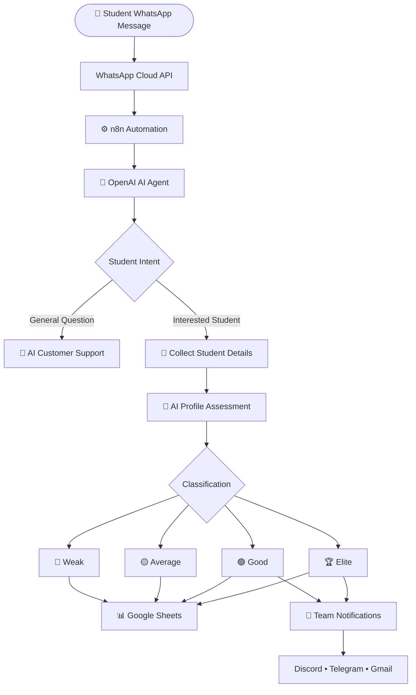
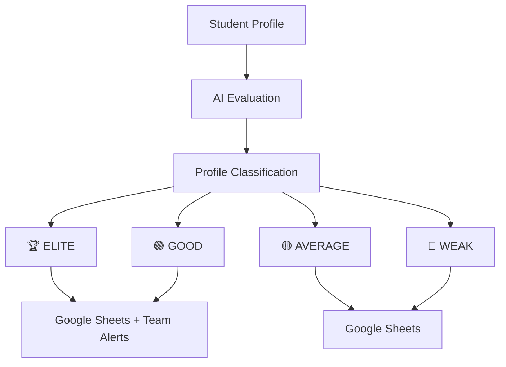

# 🤖 WhatsApp AI Customer Support & Student Intake System

  

  <b>Automating Student Support. Qualifying Leads. Empowering Consultants.</b>

  
  
  
  

## 💡 About the Project

An AI-powered WhatsApp automation system designed for study abroad consultancies.

It handles student inquiries, answers study-abroad questions, collects student information, evaluates academic profiles, and automatically categorizes potential leads.

**The goal:** Reduce repetitive work for admission counselors and help them focus on serious student inquiries.

## ⚡ What Does It Automate?

<table>
<tr>
<td width="50%" align="center">

### 💬 AI Customer Support

Instant responses to student questions about universities, tuition fees, admission requirements, IELTS/PTE, and study destinations.

</td>
<td width="50%" align="center">

### 📝 Student Intake

Automatically collects personal details, education, academic results, preferred country, English proficiency, and other relevant information.

</td>
</tr>
<tr>
<td width="50%" align="center">

### 🎯 AI Profile Assessment

Automatically evaluates student profiles and categorizes them into four qualification levels.

</td>
<td width="50%" align="center">

### 🔔 Smart Notifications

Sends notifications for Good and Elite profiles through Discord, Telegram, and Gmail.

</td>
</tr>
</table>

## 🔄 How It Works

## 🎯 Student Qualification System

Every submitted student profile is automatically evaluated and assigned to one of four categories.

| Profile | Google Sheets | Team Notification |
|---|---|---|
| 🏆 Elite | Elite Tab | Discord, Telegram, Gmail |
| 🟢 Good | Good Tab | Discord, Telegram, Gmail |
| 🟡 Average | Average Tab | Database Update |
| 🔴 Weak | Weak Tab | Database Update |

*These are internal lead-prioritization categories, not visa approval predictions.*

## 🛠️ Technology Stack

  
  &nbsp;&nbsp;&nbsp;
  
  &nbsp;&nbsp;&nbsp;
  
  &nbsp;&nbsp;&nbsp;
  
  &nbsp;&nbsp;&nbsp;
  
  &nbsp;&nbsp;&nbsp;
  
  &nbsp;&nbsp;&nbsp;
  

  
    n8n &nbsp; • &nbsp; OpenAI &nbsp; • &nbsp; WhatsApp Cloud API &nbsp; • &nbsp; Google Sheets &nbsp; • &nbsp; Gmail &nbsp; • &nbsp; Discord &nbsp; • &nbsp; Telegram
  

## 🎥 Complete Workflow Demonstration

  
   
  <b>▶ Watch the Complete Project Demo</b>
   
  See AI customer support, student intake, profile classification, database updates, and team notifications in action.

## 🚀 Business Value

- Reduced repetitive inquiries handled manually by counselors.
- Automated student information collection.
- Organized student profiles in separate categories.
- Faster identification of promising leads.
- Centralized student records and internal notifications.

## 👨‍💻 Developed By

**Moiz Qadeer**  
AI Automation Engineer | n8n Workflow Developer

Building intelligent automation systems that solve real business problems.

💼 [LinkedIn](https://www.linkedin.com/in/moizqadeer/)  

---

  <b>Built using n8n, OpenAI & WhatsApp Cloud API</b>

